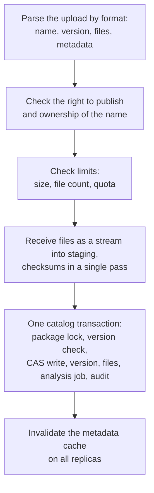

A  is where teams publish their own packages. CRANE is the source of truth for them: it accepts files as a stream, checks them, commits a version in a single transaction and decides when the version becomes visible to clients.

This page describes the path of a version from the start of an upload to release, then the life of a package and how it is stored. The immutability guarantees are covered in , and the rules for names in .

## What a hosted repository is {#what}

A hosted repository belongs to one package format and to a . A developer publishes to it with the standard command of their client, with no extra tools. Client connection is described in , and client setup in .

The right to publish depends on the role and on the kind of repository. The `developer` role publishes to dev and snapshot repositories, and the `maintainer` role publishes to the release repositories of its namespaces. A robot and a CI job publish with their own tokens and explicit permissions (). Protective repository settings, for example skipping checks in a dev repository, are changed by a separate operation and require a fresh MFA. Roles are described in .

## Atomic publishing {#publish}

A publication either completes entirely or leaves no trace visible to clients.

*Figure 1. A version becomes visible to clients only after the catalog transaction completes.*

1. CRANE parses the upload according to the format: name, version, files, metadata.
2. CRANE checks the right to publish and ownership of the name.
3. CRANE checks the limits: size, file count, the quota of the team and the repository.
4. CRANE receives each file as a stream, without buffering in memory, and computes SHA-256, SHA-512, SHA-1 and MD5 in a single pass. If the client sent a checksum, CRANE compares it with the computed one.
5. In one catalog transaction CRANE takes a lock on the package, checks that the version does not exist yet, copies the files into the , records the version, the files and an audit event, and queues an analysis job.
6. After the transaction completes, CRANE invalidates the package metadata cache on all replicas.

The analysis job (SBOM, scanning) runs asynchronously on a worker and does not delay the response to the client. What this scheme guarantees for parallel and repeated requests is described in .

> [!PLATFORM]-
> **What remains after a failure**
>
> A failure before the transaction completes leaves only an object under `staging/`, which the storage removes by a lifecycle rule after 24 hours. A failure between the copy into the CAS and the end of the transaction leaves a  without references, which garbage collection removes after a grace period. Clients see neither.

## Version states and promotion {#promotion}

A version passes through the states `Staging`, `Quarantined`, `Released`, `Blocked` and `Deleted`. The diagram and the meaning of the states are described in . The repository policy sets the initial state after publishing; for dev repositories the policy may skip `Quarantined`.

The transition from `Quarantined` to `Released` is called promotion. Promotion evaluates a set of checks (gates) and approvals:

- **cve** reads scan results and VEX statements;
- **license** reads the SBOM and evaluates licenses against the policy;
- **provenance** reads data about where the version came from and requires a valid attestation when so configured for the repository and stage;
- **quality** reads the quality gate result from SonarQube.

A version without suitable evidence does not leave the `Quarantined` state. A gate does not know the kinds of evidence: each gate declares which evidence it reads. A new evaluation starts on new evidence, a new vulnerability database version, an expired exception and a policy change.

Promotion changes only a row in the catalog: the  and the bytes of the version stay the same. For this reason releasing, blocking and restoring a version are instant and reversible. How the vulnerability flow, evidence and licenses work is described in ,  and .

A package from a proxy repository can be promoted into an internal hosted repository. CRANE then copies the  from the `proxy-cache` storage class to the `primary` class: the durability of a release must not depend on a cache that may be lost.

## Package lifecycle {#package-lifecycle}

A package, unlike a version, has three states: `active`, `deprecated` and `eol`. A library owner marks a package as deprecated and assigns a replacement. Search ranks a deprecated package lower and shows the recommended replacement (). The `maintainer` role can mark a package as deprecated, and an external agent using the A2A protocol can propose such an action, which a human must confirm ().

## Hiding and deleting a version {#hide-delete}

A published version cannot be changed, but it can be hidden or deleted.

- **Hiding** removes the version from dependency resolution. A  is reversible, and the version stays available by its exact number.
- **Deleting** leaves a : the bytes are no longer served and the version number cannot be taken again.

How each ecosystem hides and deletes versions is described in the table in .

## Storage, quotas and cleanup {#storage}

A  lies in the  under its . Identical files in different repositories of one store are kept once. The full path of the bytes is described in .

- **Storage class.** A repository gets a storage class. Hosted releases, evidence and SBOMs live in the `primary` class, which needs replication and backup. The `archive` class suits old versions, and the `restricted` class suits data that needs separate placement. A class points to a physical store; by default there is one.
- **Quotas.** The size of a team and of a repository is counted logically, by the references from files to blobs. A quota has a warning and a hard limit. Splitting the storage physically by team is not needed.
- **Retention.** Cleanup rules work by age, version count and, for SNAPSHOT, by recent builds. Before a rule is applied, it runs in dry-run mode: the report lists the versions and the size without deleting anything. Holds protect versions from cleanup. Instead of deleting, a version can be archived: the blob moves to the `archive` class, and the move verifies SHA-256 and switches the references in one transaction.
- **Garbage collection.** A blob is deleted in two phases. First CRANE marks a blob that has no references and no active upload. Then a blob that stays unreferenced for more than 24 hours is deleted. If a reference appears again, the mark is cleared.

Settings: , , .

## Related pages {#related}

- 
- 
- 
- 
