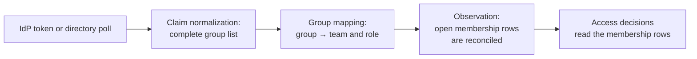

A team in CRANE is a . It owns , packages, repositories and robots, and people belong to it with roles. There is no separate "team" entity: the console calls it "Team (workspace)", and the API and configuration call it `workspace`.

This page describes the team lifecycle, the sources of roles, how IdP groups map to teams, the rules of ownership and transfer, cross-team access and which team downloads are attributed to. The permissions of the roles and the separation of duties are described in .

## A team and a workspace {#team-is-workspace}

A team is the unit of ownership and membership. There is no hierarchy of teams. Access policies refer to the team's identifier (a UUID), not to its slug, so renaming the slug does not change the policies.

A team slug follows the grammar `^[a-z0-9][a-z0-9-]{1,62}$`: it is safe in URLs and is never reused, even after a team is archived. The grammar can be widened but not narrowed.

## Team lifecycle {#lifecycle}

| Action | Who | Conditions |
| --- | --- | --- |
| Create | Platform administrator | The slug matches the grammar and is unique for all time |
| Change name and description | Team owner, platform administrator | The slug does not change |
| Archive, unarchive | Platform administrator with  | Archiving is allowed only when the team owns nothing |

Archiving is possible when the team has no namespaces, no packages without a namespace, no repositories, no active robots, no trust policies and no active cross-team grants as a resource owner. Otherwise CRANE answers `409` and lists the resources.

Archiving closes the open membership rows, disables the team's robots and revokes their credentials. New membership rows are not opened for an archived team. There is no hard delete, because history refers to the team. There are no orphaned packages: a package always has an owner, and a team with resources cannot be archived.

A team without an owner is allowed, for example when the IdP removed all owners. Such a team is flagged in the access review report and with a badge in the console, and a platform administrator acts for it. The API cannot remove the last local owner when there are no owners from the IdP.

## Principals {#principals}

A  is the party on whose behalf an action is performed. There are three kinds.

- **A human** is identified by the pair "OIDC issuer and subject". A change of IdP creates new people; there is no merging.
- **A robot** is created by a team owner and belongs to the team.
- **A workload** is a CI project or a Kubernetes ServiceAccount. There is one principal per pair "issuer and stable claim": for GitLab it is the project ID, not the project path. A workload appears at the first exchange of a platform token, and its team is the team of the trust policy.

If the trust policy rules that match a platform token belong to more than one team, the exchange is rejected () with diagnostics. Robots and workloads are not transferred between teams: disable the existing one and create a new one.

## Roles and membership {#membership}

A team has four roles: `reader`, `developer`, `maintainer` and `owner`; each includes the permissions of the previous one. A person's effective role in a team is the maximum over all of their open membership rows.

A membership row has two sources:

- **`idp`**: the fact is observed from the token, the directory or IdP push events;
- **`local`**: a team owner adds and removes the role through the API.

A team that has a group mapping is managed by the IdP, and local rows are an addition. A team without a mapping is managed only locally. An instance setting can forbid local membership if the organization does not allow permissions outside the IdP.

Membership is stored over time. A row gets `valid_from` when CRANE saw the fact, not when it changed in the IdP, and `valid_to` when the fact disappeared. The history is append-only and is recorded in the journal together with the observation channel (sign-in, token exchange, refresh, directory poll, push). The team sees the current members; only the owner, SecOps and the auditor see the past.

Access decisions read only the membership rows, and the IdP token is only observed. For this reason a change of roles takes effect without reissuing tokens ().

## IdP groups {#idp}

Permissions from the IdP enter CRANE through a single path.

*Figure 1. The only path of permissions from the IdP. A group without a mapping grants nothing.*

- **The mapping is explicit.** An IdP group maps to a pair "team and role" or to an instance role. A group without a mapping grants nothing, and a group does not create a team: the platform administrator creates teams.
- **The platform administrator maintains the mappings** with , because a mapping grants permissions.
- **The group name is not parsed.** For Keycloak the recommended name is `/crane/<slug>/<role>`, and the console prefills it when a mapping is created. But CRANE does not parse the group path: only explicit mappings grant permissions.
- **Unknown is not empty.** If a token does not carry the complete list of groups, roles do not change.

Roles reach CRANE through channels that complement each other: at sign-in and token refresh, at the exchange of a platform token, by a directory poll (for Keycloak, through the Admin REST API, read-only, every 5 minutes) and by push events (Keycloak admin events, a subset of SCIM 2.0 for other providers). Without a directory and push, a role removed in the IdP stays in effect until the next sign-in or token refresh.

CRANE has no vendor adapters for Entra, Google or GitLab: it accepts any provider with standard . LDAP, Active Directory and SAML connect through a federating provider, not directly. Setup: .

## Ownership {#ownership}

- A namespace belongs to one team. All packages inside it belong to that team too.
- A package without a namespace belongs to the team that published it.
- A repository belongs to one team.

The owner of a package is the team of its namespace, and if there is no namespace, the team recorded on the package. The first publication of a new name claims it for the team ().

Different teams under one scope can get different, narrower namespaces: the longest match applies. A namespace that overlaps (nests in or covers) the namespace of another team is created only by the platform administrator with step-up. Within one team, nested namespaces are created freely. The owner of a parent namespace cannot delegate a nested one to another team.

## Ownership transfer {#transfer}

A transfer is one action: a resource (a namespace, a package without a namespace or a repository), the receiving team and a justification. It can be performed by someone who is an owner in both teams, or by the platform administrator, always with step-up. The transfer applies immediately, with no request and no consent step from the recipient. The history stays in the journal as `ownership.transferred` and `package.claimed` events, and there are no separate transfer tables. Robots and trust policies belong to a team and are not transferred.

## Cross-team access {#cross-team}

The team that owns a resource can give another team the `reader`, `developer` or `maintainer` role on its namespace or repository, with an optional expiry. The grant is created by an owner of the resource's team with step-up; it can be revoked by the same owner or by the platform administrator.

By default the private repositories of other teams are not visible: a client gets `404`. A grant goes not to all members of the receiving team, but to those whose role in it is not lower than the grant's role: a `maintainer` grant goes to maintainers and owners, a `reader` grant goes to everyone.

Two typical scenarios:

- team A reads the private repository of team B: B gives A the `reader` role on the repository;
- a platform team lets a product team publish to a shared namespace: the `maintainer` role on the namespace.

## Download attribution {#attribution}

Every download belongs to a team. Credential issuance records the team, not the download, and after issuance it does not change.

- **A robot and a workload** always charge the team of the principal.
- **A human** in one team charges that team. A human in several teams chooses the team when issuing a token: `cctl login --team <slug>`, the console switcher or the team field in the token request (). Different teams need different tokens.
- **Without a choice**, with several teams, downloads go to the "unassigned" row.

A change of team composition in the middle of a session does not change the attribution of an issued token until it is reissued. A download copies the value from the credential without any calculation.

For reports CRANE builds a daily download aggregate by team, repository, package and source (`hosted`, `hit`, `stale`, `miss`, `coalesced`) and keeps it for 400 days. The aggregate holds no identities and no count of unique people. Identities stay in the download journal, which the SecOps role can read (). A team owner sees only the trace of their own team, and the platform administrator and SecOps see any. Metrics by team are limited to the N largest teams; the rest go to the `other` bucket, and unassigned downloads go to the `none` bucket ().

## Related pages {#related}

- 
- 
- 
- 
