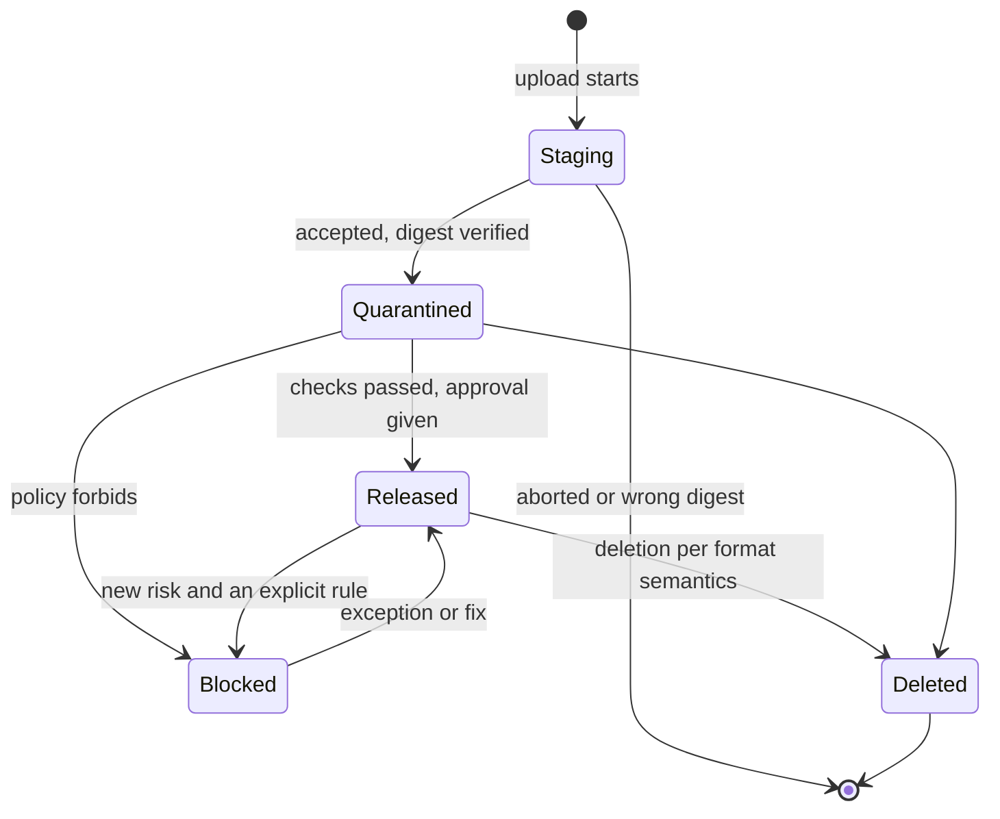

CRANE guarantees that a released package version does not change: it cannot be overwritten, and the number of a deleted version cannot be taken again. This protects builds that pin a version in a lockfile from having the file swapped under the same number.

The guarantee holds in all five formats. A version can be hidden or deleted, but not modified.

## Threat {#threat}



An attacker obtains a publishing token and uploads a different file into an existing version. Clients that pinned `1.4.2` get someone else's code under a familiar number on their next install. Deleting a version and publishing it again under the same number gives the same result.


- A released version cannot be overwritten. Publishing an existing version again gets a `409` response.
- Two parallel publications of the same version produce exactly one success.
- Deletion leaves a : the bytes are no longer served and the version number cannot be taken again.
- Bytes in  never change: a file with different content gets a different address.



## Guarantee {#guarantee}

- A released version cannot be overwritten. Publishing an existing version again gets a `409` response.
- Two parallel publications of the same version produce exactly one success.
- Repeating a request with the same `Idempotency-Key` returns the same result, not a second version.
- An unfinished upload is invisible to clients.
- Deletion leaves a : the bytes are no longer served and the version number cannot be taken again.
- Bytes in  never change: a file with different content gets a different address.



## How it works {#mechanism}

### Bytes and visibility {#bytes-and-visibility}

A  is stored under its SHA-256 , and its path is computed from that digest. Identical files in different repositories of the same storage are stored once. The visibility of a version is determined by its state and by policies, not by the bytes. Promoting a version between stages changes only a row in the catalog.

### Atomic publishing {#atomic-publish}

CRANE receives files as a stream and computes digests while receiving. A version becomes visible in a single catalog transaction: until it completes, clients do not see the version. The transaction takes a lock per package, so two publications of the same version never overlap: the second one sees the existing version and gets `409`.

> [!PLATFORM]-
> **What remains after a failure**
>
> A failure before the transaction completes leaves only an object under `staging/`; the storage lifecycle rule deletes it after 24 hours. A failure between the copy into CAS and the end of the transaction leaves a blob without references; garbage collection removes it after a grace period. Clients see neither.

### Version states {#states}

The `Staging` state is invisible to clients. The `Deleted` state leaves a tombstone, and a release number cannot be taken again. For dev repositories, a policy may skip the `Quarantined` state. This is a version state in a ; it is unrelated to the quarantine of new upstream versions.

Format flags exist independently of the state: `yanked` (PyPI, Cargo, NuGet), `deprecated` (npm, NuGet) and dist-tags (npm).

### Deletion, hiding and overwriting by format {#formats}

"Hiding" removes a version from dependency resolution without deleting it. A , in the formats that have one, is reversible, and the version stays available by its exact number.

| Format | Overwriting a release | Hiding | Deletion | Mutable |
| --- | --- | --- | --- | --- |
| Maven | Forbidden | Not in the protocol; the `Blocked` state with diagnostics | Tombstone, the number is not reused | SNAPSHOT: every timestamped build is a separate immutable version |
| npm | Forbidden (as on npmjs) | `deprecate`, moving a dist-tag | `unpublish` by policy (72 h window), tombstone | None; pre-releases through dist-tags |
| PyPI | Forbidden, a file name is unique forever | `yank` () | Tombstone, the file name is not reused | None; `.devN` dev releases |
| NuGet | Forbidden | `unlist` | Tombstone | None; pre-release suffixes |
| Cargo | Forbidden, the "crate + version" pair is immutable | `yank` and the reverse `unyank` (the version stays available through a lockfile) | Tombstone, the version is not reused (as on crates.io) | None; SemVer pre-releases (`1.0.0-rc.1`) |

### Maven SNAPSHOT {#snapshots}

CRANE does not make a SNAPSHOT mutable. Every timestamped build, for example `1.0-20261028.123456-3`, is a separate immutable version. The name `1.0-SNAPSHOT` is a view in `maven-metadata.xml`: it points to the current builds. The retention policy keeps several of the latest builds and those downloaded recently (starting values: the 5 latest timestamped builds and everything downloaded in the last 14 days). The rest move to the `Deleted` state with the same transition as any deleted version. The price is that tombstones of CI builds accumulate.

### NuGet unlist {#nuget-unlist}

In NuGet, `unlist` and the later `relist` are the same yank and its reverse: the version is hidden from selection, stays available by its exact number, and the action is reversible. CRANE has no separate "unlisted" state.

### Proxy repositories {#proxy}

Files from an  are cached indefinitely: the entry key includes the path and the digest, and the content is immutable. If the upstream changes a file under the same number, CRANE gets a different digest and does not accept the file when the expected digest is known ().

## Limits of the guarantee {#limits}

> [!LIMITS]
> - The guarantee covers immutability, not the safety of the content. A malicious version stays the same malicious version; it is hidden by a block or deleted, but not "fixed" in place ().
> - Hiding and blocking do not change bytes and are reversible. Deletion is irreversible in the sense that the version number cannot be taken again and the bytes are not served.
> - The npm `unpublish` window is set by policy (72 hours); once it has closed, the version cannot be removed this way.
> - For Maven SNAPSHOT, the price of immutability is the accumulation of CI build tombstones.
> - The protection works at the level of CRANE. Writing directly to PostgreSQL or to blob storage, bypassing CRANE, is the deployment's responsibility: restrict access to them with platform tools.

## Related settings {#configure}


