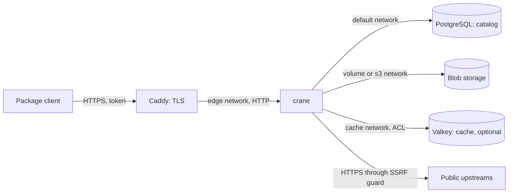

This section describes the security of a CRANE deployment on Docker Compose as it is today: the request path from the client through Caddy and `crane` to PostgreSQL, the  storage, the cache and the , and for each trust boundary what the shipped files protect and what stays with the deployment administrator.

The target guarantees of the product are described in the  section. This page covers only what the code and the shipped files confirm. Differences are stated plainly. For example, access to the protocols is currently protected by a single , and the server has no roles and no OIDC sign-in yet.

## The request path {#request-path}

The client reaches Caddy over HTTPS. Caddy forwards the request to the `crane` server over HTTP inside the `edge` network. The server reads the catalog in PostgreSQL, package bytes in the blob storage and, when Valkey is enabled, the cache. The server itself calls the public upstreams, through a single HTTP client that checks addresses.

## Trust boundaries {#boundaries}

### Client and Caddy {#client-caddy}

- Caddy terminates TLS. For a public name it obtains an ACME certificate; for `localhost` it uses its internal CA. The second option suits a trial, not production.
- The `crane` server does not terminate TLS: it listens on a plain TCP port. A token presented around Caddy travels over the network in clear text.
- There is no anonymous access to the protocols. A request without a token gets `401`, a request with a wrong token gets `403`: .

### Caddy and crane {#caddy-crane}

- The `edge` network connects only `caddy` and `crane`. Its subnet matches the trusted proxy list ( is passed to the server as ).
- The server trusts `X-Forwarded-For` and `X-Request-Id` only from proxies on that list. Caddy removes the client `X-Request-Id`, and the server issues the request identifier itself.
- The probe port () answers without a token and listens on all interfaces of the container. Compose does not publish it: .

### crane and the catalog {#catalog}

- PostgreSQL holds the catalog, and its port is not published. The password and the catalog URL live in secret files, not in environment variables.
- When the catalog does not answer, CRANE does not call the upstream in its place (): without the catalog it cannot check that a name is not internal. The guarantee: .

### crane and the blob storage {#blobs}

- By default blobs live in the local `blobs` volume. In S3 mode the SeaweedFS storage runs in the `s3` network with the `internal: true` flag, there is no anonymous access, and the keys live in secret files: .
- Blobs are addressed by SHA-256 digest: .

### crane and the cache {#cache}

- By default the cache sits in process memory. Valkey is added by an override file: the `cache` network with the `internal: true` flag, mandatory authentication, the `default` user switched off.
- The cache holds proxy document bodies and pointers to blobs. Whoever writes to Valkey can replace that data, so isolation and the password are mandatory: .

### crane and the upstream {#upstream}

- Upstream addresses are built into the binary, and the configuration sets only the names of proxy repositories: .
- All outgoing traffic goes through a single HTTP client that checks the host and the address after DNS. Every fetch is written to the egress log: .

## What is protected today {#protected}

- Internal names set in  are never served by the proxy from an upstream: .
- A version number, once taken, is not released: .
- Outgoing requests pass through the SSRF guard: .
- An unavailable catalog leads to a refusal, not to skipped checks: .
- The CRANE services in Compose run with a read-only root file system, without privileges and as an unprivileged user: .
- The three streams of the  are written regardless of the ordinary log level: .

## What stays with the deployment {#deployment-side}

- **Distribution of the token.** The token is one for the whole instance: it opens all repositories for reading and writing. Whoever holds it has full access. Roles and OIDC sign-in do not work in the server yet: .
- **Secrets on disk.** Permissions on the `secrets` directory, backups, and replacing the token and passwords stay with the administrator: .
- **Network and host.** The firewall, DNS, access to ports `80` and `443`, the security of the Docker host and disks. Compose does not restrict resources or privileges of the third-party containers (`caddy`, `postgres`, `valkey`, `seaweedfs`).
- **Channels inside Docker.** In the reference files `crane` talks to PostgreSQL, Valkey and SeaweedFS without TLS. For external services TLS is set in their addresses.
- **Journal durability.** The server writes journal lines to standard output. Collection, retention and protection against modification belong to the organization's log pipeline. The server has no SIEM export yet.

## What's next {#next}

-  — hardening a Compose deployment.
-  — security journal events and their fields.
-  — how to report a vulnerability in CRANE.
-  — verifying release authenticity.
