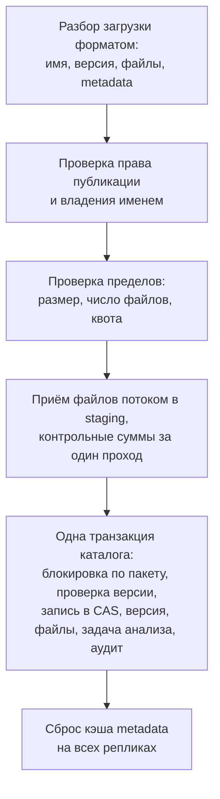

 — место, куда команды публикуют собственные пакеты. CRANE для них источник истины: принимает файлы потоком, проверяет их, фиксирует версию одной транзакцией и решает, когда версия становится видимой клиентам.

Страница описывает путь версии от начала загрузки до выпуска, а затем жизнь пакета и его хранение. Гарантии неизменяемости вынесены на страницу , правила имён — на страницу .

## Что такое hosted-репозиторий {#what}

Hosted-репозиторий относится к одному формату пакетов и принадлежит . Разработчик публикует в него штатной командой своего клиента, без дополнительных утилит. Подключение клиентов описано на странице , настройка клиентов — на странице .

Право публикации зависит от роли и от вида репозитория. Роль `developer` публикует в dev- и snapshot-репозитории, роль `maintainer` — в release-репозитории своих namespace. Робот и задача CI публикуют по своим токенам с явными правами (). Защитные настройки репозитория, например пропуск проверок в dev-репозитории, меняются отдельной операцией и требуют свежего MFA. Роли описаны на странице .

## Атомарная публикация {#publish}

Публикация либо завершается целиком, либо не оставляет следов, видимых клиентам.

*Рисунок 1. Версия видима клиентам только после завершения транзакции каталога.*

1. CRANE разбирает загрузку в соответствии с форматом: имя, версия, файлы, metadata.
2. CRANE проверяет право публикации и владение именем.
3. CRANE проверяет пределы: размер, число файлов, квоту команды и репозитория.
4. CRANE принимает каждый файл потоком, без буферизации в памяти, и за один проход считает SHA-256, SHA-512, SHA-1 и MD5. Если клиент прислал контрольную сумму, CRANE сверяет её с вычисленной.
5. В одной транзакции каталога CRANE берёт блокировку по пакету, проверяет, что версии ещё нет, копирует файлы в , записывает версию, файлы и событие аудита и ставит задачу анализа.
6. После завершения транзакции CRANE сбрасывает кэш metadata пакета на всех репликах.

Задача анализа выполняется воркером асинхронно (SBOM, сканирование) и не задерживает ответ клиенту. Что гарантирует такая схема при параллельных и повторных запросах, описано на странице .

> [!PLATFORM]-
> **Что остаётся после сбоя**
>
> Сбой до завершения транзакции оставляет только объект в области `staging/`, который хранилище удаляет по правилу жизненного цикла через 24 часа. Сбой между копированием в CAS и завершением транзакции оставляет  без ссылок, его забирает сборка мусора после grace period. Клиенты не видят ни того, ни другого.

## Состояния версии и продвижение {#promotion}

Версия проходит состояния `Staging`, `Quarantined`, `Released`, `Blocked` и `Deleted`. Диаграмма и значения состояний описаны на странице . Начальное состояние после публикации задаёт политика репозитория; для dev-репозиториев политика может пропускать `Quarantined`.

Переход из `Quarantined` в `Released` называется продвижением. Продвижение оценивает набор проверок (gates) и согласования (approvals):

- **cve** читает результаты сканирования и VEX-заявления;
- **license** читает SBOM и оценивает лицензии по политике;
- **provenance** читает данные о происхождении версии и требует валидную attestation, если так настроено для репозитория и стадии;
- **quality** читает результат quality gate из SonarQube.

Версия без подходящего evidence не выходит из состояния `Quarantined`. Проверка не знает видов доказательств: каждый gate объявляет, какие доказательства читает. Повторная оценка запускается при новом evidence, новой версии базы уязвимостей, истечении исключения и изменении политики.

Продвижение меняет только строку в каталоге:  и байты версии те же. Поэтому выпуск, блокировка и возврат версии мгновенны и обратимы. Как устроены поток уязвимостей, evidence и лицензии, описано на страницах ,  и .

Пакет из proxy-репозитория можно продвинуть во внутренний hosted-репозиторий. Тогда CRANE копирует  из класса хранения `proxy-cache` в класс `primary`: сохранность релиза не должна зависеть от кэша, который разрешено потерять.

## Жизненный цикл пакета {#package-lifecycle}

У пакета, в отличие от версии, три состояния: `active`, `deprecated` и `eol`. Владелец библиотеки помечает пакет устаревшим и назначает замену. Поиск понижает устаревший пакет и показывает рекомендованную замену (). Роль `maintainer` может пометить пакет устаревшим, а внешний агент по протоколу A2A — предложить такое действие с обязательным подтверждением человеком ().

## Скрытие и удаление версии {#hide-delete}

Опубликованную версию нельзя изменить, но можно скрыть или удалить.

- **Скрытие** убирает версию из выбора при разрешении зависимостей.  обратим, версия остаётся доступной по точному номеру.
- **Удаление** оставляет : байты больше не отдаются, номер версии занять нельзя.

Как именно скрывает и удаляет версии каждая экосистема, описано в таблице на странице .

## Хранение, квоты и очистка {#storage}

 лежит в  под своим . Одинаковые файлы в разных репозиториях одного хранилища хранятся один раз. Полный путь байтов описан на странице .

- **Класс хранения.** Репозиторий получает класс хранения. Hosted-релизы, evidence и SBOM лежат в классе `primary`, для которого нужны репликация и резервное копирование. Класс `archive` подходит для старых версий, класс `restricted` — для данных с требованием отдельного размещения. Класс указывает на физическое хранилище; по умолчанию оно одно.
- **Квоты.** Объём команды и репозитория считается логически, по ссылкам файлов на blob. У квоты есть предупреждение и жёсткий предел. Физически делить хранилище по командам не нужно.
- **Retention.** Правила очистки работают по возрасту, числу версий и для SNAPSHOT. Перед применением правило запускается в режиме dry run: отчёт перечисляет версии и объём, ничего не удаляя. Удержания (holds) защищают версии от очистки. Вместо удаления версию можно архивировать: blob переносится в класс `archive`, а перенос проверяет SHA-256 и в одной транзакции переключает ссылки.
- **Сборка мусора.** Blob удаляется в два этапа. Сначала CRANE помечает blob без ссылок и без активной загрузки. Затем blob, который остаётся без ссылок дольше 24 часов, удаляется. Если ссылка появилась снова, пометка снимается.

Настройки: , , .

## Связанные страницы {#related}

- 
- 
- 
- 
