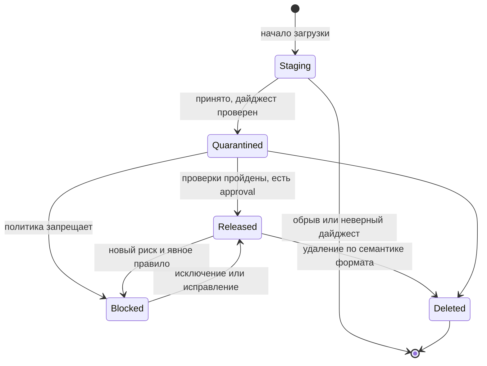

CRANE гарантирует, что выпущенная версия пакета не меняется: её нельзя перезаписать, а номер удалённой версии нельзя занять снова. Это защищает сборки, которые закрепили версию в lockfile, от подмены файла под тем же номером.

Гарантия действует во всех пяти форматах. Скрыть версию или удалить её можно, изменить — нет.

## Угроза {#threat}



Атакующий получает токен публикации и загружает в уже существующую версию другой файл. Клиенты, которые закрепили `1.4.2`, при следующей установке получают чужой код под знакомым номером. Тот же результат даёт удаление версии и повторная публикация под тем же номером.


- Выпущенную версию нельзя перезаписать. Повторная публикация существующей версии получает ответ `409`.
- Две параллельные публикации одной версии дают ровно один успех.
- Удаление оставляет : байты больше не отдаются, номер версии занять нельзя.
- Байты в  не меняются никогда: файл с другим содержимым получает другой адрес.



## Гарантия {#guarantee}

- Выпущенную версию нельзя перезаписать. Повторная публикация существующей версии получает ответ `409`.
- Две параллельные публикации одной версии дают ровно один успех.
- Повтор запроса с тем же `Idempotency-Key` возвращает тот же результат, а не вторую версию.
- Незавершённая загрузка невидима клиентам.
- Удаление оставляет : байты больше не отдаются, номер версии занять нельзя.
- Байты в  не меняются никогда: файл с другим содержимым получает другой адрес.



## Как это устроено {#mechanism}

### Байты и видимость {#bytes-and-visibility}

 хранится под своим  SHA-256, и путь к нему вычисляется из дайджеста. Одинаковые файлы в разных репозиториях одного хранилища хранятся один раз. Видимость версии определяют её состояние и политики, а не байты. Продвижение версии между стадиями меняет только строку в каталоге.

### Атомарная публикация {#atomic-publish}

CRANE принимает файлы потоком и считает дайджесты во время приёма. Версия становится видимой в одной транзакции каталога: до её завершения клиенты версию не видят. Транзакция берёт блокировку по пакету, поэтому две публикации одной версии не пересекаются: вторая видит существующую версию и получает `409`.

> [!PLATFORM]-
> **Что остаётся после сбоя**
>
> Сбой до завершения транзакции оставляет только объект в области `staging/`; правило жизненного цикла хранилища удаляет его через 24 часа. Сбой между копированием в CAS и завершением транзакции оставляет blob без ссылок; его забирает сборка мусора после grace period. Ни то ни другое не видно клиентам.

### Состояния версии {#states}

Состояние `Staging` клиентам не видно. Состояние `Deleted` оставляет tombstone, и номер релиза нельзя занять повторно. Для dev-репозиториев политика может пропускать состояние `Quarantined`. Это состояние версии в , оно не связано с карантином новых версий upstream.

Ортогонально состоянию живут флаги формата: `yanked` (PyPI, Cargo, NuGet), `deprecated` (npm, NuGet) и dist-tags (npm).

### Удаление, скрытие и перезапись по форматам {#formats}

«Скрытие» убирает версию из выбора при разрешении зависимостей, но не удаляет её. Команда  в форматах, где она есть, обратима, и версия остаётся доступной по точному номеру.

| Формат | Перезапись release | Скрытие | Удаление | Изменяемое |
| --- | --- | --- | --- | --- |
| Maven | Запрещена | Нет в протоколе; состояние `Blocked` с диагностикой | Tombstone, номер не переиспользуется | SNAPSHOT: каждая timestamp-сборка — отдельная неизменяемая версия |
| npm | Запрещена (как в npmjs) | `deprecate`, перенос dist-tag | `unpublish` по политике (окно 72 ч), tombstone | Нет; pre-release через dist-tags |
| PyPI | Запрещена, имя файла уникально навсегда | `yank` () | Tombstone, имя файла не переиспользуется | Нет; dev-релизы `.devN` |
| NuGet | Запрещена | `unlist` | Tombstone | Нет; pre-release суффиксы |
| Cargo | Запрещена, пара «крейт + версия» неизменяема | `yank` и обратный `unyank` (версия остаётся доступной по lockfile) | Tombstone, версия не переиспользуется (как на crates.io) | Нет; pre-release по SemVer (`1.0.0-rc.1`) |

### Maven SNAPSHOT {#snapshots}

CRANE не делает SNAPSHOT изменяемым. Каждая timestamp-сборка, например `1.0-20261028.123456-3`, — отдельная неизменяемая версия. Имя `1.0-SNAPSHOT` служит представлением в `maven-metadata.xml`: оно указывает на актуальные сборки. Политика хранения оставляет несколько последних сборок и те, что скачивались в последнее время (стартовые значения: 5 последних timestamp-сборок и всё, что скачивалось за 14 дней). Остальные переходят в состояние `Deleted` тем же переходом, что и любая удалённая версия. Платой за это становятся tombstone сборок CI: они накапливаются.

### NuGet unlist {#nuget-unlist}

В NuGet `unlist` и повторный `relist` — это тот же yank и обратный ему: версия скрыта из выбора, доступна по точному номеру, действие обратимо. Отдельного состояния «unlisted» в CRANE нет.

### Proxy-репозитории {#proxy}

Файлы из  кэшируются бессрочно: ключ записи включает путь и дайджест, а содержимое неизменяемо. Если upstream изменит файл под тем же номером, CRANE получит другой дайджест и не примет файл, когда ожидаемый дайджест известен ().

## Границы гарантии {#limits}

> [!LIMITS]
> - Гарантия касается неизменяемости, а не безопасности содержимого. Вредоносная версия остаётся той же вредоносной версией; её скрывают блокировкой или удаляют, но не «исправляют» на месте ().
> - Скрытие и блокировка не меняют байты и обратимы. Удаление необратимо в том смысле, что номер версии занять нельзя, а байты не отдаются.
> - Окно `unpublish` в npm задаёт политика (72 часа); после его закрытия версию нельзя снять этим способом.
> - Для SNAPSHOT в Maven цена неизменяемости — накопление tombstone сборок CI.
> - Защита действует на уровне CRANE. Прямая запись в PostgreSQL и в хранилище blob в обход CRANE находится на стороне развёртывания: доступ к ним ограничивают средствами платформы.

## Связанные настройки {#configure}


